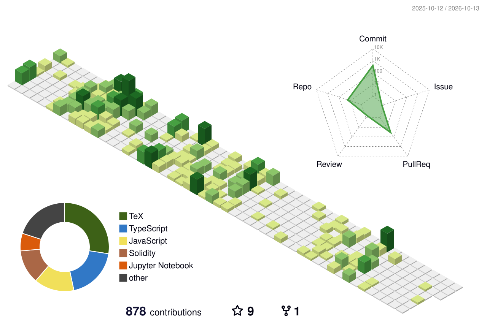

<!-- ====== BERSERK • MINIMAL & COMPACT ====== -->

  

  <!-- Hero -->
  

  

  
  <h1>Harshana Lakshara Fernando</h1>
  
<b>CS @ University of Moratuwa</b> • Cloud-Native • Distributed Systems • GenAI + DevOps • Web3

  <!-- Socials / quick links (keep only working links) -->
        

  <!-- Quick facts -->
  
  
  
  

  

<!-- ===== 🙋 About ===== -->

  
<b>🙋 About me</b>

  

    <em>
      Hello! I'm Harshana Fernando, a <b>final-year</b> undergraduate at the
      <a href="https://uom.lk/" title="Wisdom is all wealth"><b>University of Moratuwa</b>, Sri Lanka</a>. 
      I'm a <b>passionate self-learner</b>
      
      and a <b>software engineer</b>
      .
    </em>
  

  

    I build scalable, cloud-native applications with strengths in full-stack development, microservices, and event-driven systems using <b>Java (Spring Boot)</b>, <b>Go</b>, and modern tooling.
    I'm passionate about Generative AI with hands-on experience in RAG pipelines and LLM integration, plus exposure to Web3 and DevOps.
  

  

    Currently pursuing <b>CKA</b> and <b>AWS Solutions Architect</b> certifications to deepen my cloud-native expertise.
    When I’m not shipping production-grade backends or tuning infra, I’m grinding <b>LeetCode</b> &amp; <b>HackerRank</b>.
  

<!-- ===== 💼 Experience ===== -->

<b>💼 Experience</b>

**Software Engineer – Trading Systems** · CAL · Colombo, Sri Lanka · *Sep 2026 – Present*
- Sole engineer on CAL's in-house electronic trading platform: a direct gateway to the **Colombo Stock Exchange (CSE)**, plus the trading screens and ops tools around it
- Took over **CSE certification** part-way and carried it to the final stage: every application-level case of the 188 exchange test cases re-run on CSE's test system, each with a full exchange-message log
- **Event-sourced, CQRS** engine: a **Chronicle Queue** write-ahead log is the source of truth on the order path, with **PostgreSQL** as an async read model, so database writes never block execution
- **FIX 5.0 SP2 / FIXT 1.1** order routing and drop copy (**QuickFIX/J**), and a custom Java NIO decoder for the **MITCH** UDP market-data feed
- Built and own the Certification Runner, order lifecycle view, Ops console, Pro dealing ticket and CAL Trader

**Research and Development Engineer (Internship)** · Empathic Computing Laboratory, University of Auckland · Remote · *Mar 2026 – Aug 2026*
- Technical design of a modular mobile–wearable sensing pipeline (**Kotlin**, **WearOS**) for digital mental health research
- Turned high-frequency time-series sensor data into structured features for machine learning

**Co-founder & Lead Engineer (Freelance)** · ScaleX · Remote · *Jul 2025 – Aug 2026*
- Built **AgriNova** (Next.js, Prisma, Supabase/PostgreSQL): inventory and commission management across 5 branches, 194K+ units tracked, 860+ invoices processed
- Cut repeat dashboard data-fetch latency from ~384 ms to under 1 ms with React Query caching and pagination

**Software Engineer (Internship)** · Information Systems Associates (ISA) · Colombo, Sri Lanka · *Dec 2024 – Jun 2025*
- Owned a **Kafka**-backed PNR generation microservice, live in production: 25+ PNRs/sec/node at <100 ms latency
- Led the AeroMART → AeroOrder modernization (Strangler Fig, feature toggles, **gRPC** bridge into a Java 8 monolith)

Java 21 · Spring Boot · QuickFIX/J · Chronicle Queue · PostgreSQL · Kafka · Go · Kotlin

<!-- ===== 🌱 Open Source ===== -->

<b>🌱 Open Source</b>

| Project | Contribution | Status |
|---|---|---|
| [kgateway](https://github.com/kgateway-dev/kgateway) | [#14851](https://github.com/kgateway-dev/kgateway/pull/14851): new `kgateway_build_info` Prometheus metric, shipped in kgateway v2.5.0-beta.2 | ✅ Merged |
| [kubernetes-mcp-server](https://github.com/containers/kubernetes-mcp-server) | [#1482](https://github.com/containers/kubernetes-mcp-server/pull/1482): fixed flaky HTTP server startup in the test suite | ✅ Merged |
| [Kubeflow Spark Operator](https://github.com/kubeflow/spark-operator) | [#3249](https://github.com/kubeflow/spark-operator/pull/3249): Ginkgo unit tests for executor metrics (100% of `sparkpod_metrics.go`) and a log message fix | 🔍 In review |
| [kubernetes-mcp-server](https://github.com/containers/kubernetes-mcp-server) | [#1549](https://github.com/containers/kubernetes-mcp-server/pull/1549): test that every tool, prompt and resource declares RBAC metadata | 🔍 In review |
| [kubernetes-mcp-server](https://github.com/containers/kubernetes-mcp-server) | [#1568](https://github.com/containers/kubernetes-mcp-server/issues/1568): showed a reported "flaky" test was a real merge-order bug; the author confirmed and applied the fix | 🧩 Root-caused |
| [KEDA](https://github.com/kedacore/keda) | [#4394](https://github.com/kedacore/keda/issues/4394): `podStates` option for the workload scaler (count pods by phase / Ready) | 🛠️ Assigned |
| [Kubeflow Spark Operator](https://github.com/kubeflow/spark-operator) | [#3130](https://github.com/kubeflow/spark-operator/issues/3130): evaluated crd-ref-docs vs genref for the API reference docs migration | 🛠️ Assigned |

<!-- ===== 🎯 Goals & Focus ===== -->

<b>🎯 Goals & Focus</b>

- Build **scalable, cloud-native systems** (microservices, event-driven, high-throughput)  
- Ship **Java/Spring** & **Go** backends; optimize latency & reliability  
- Practical **RAG** and **LLM** integration  
- **Kubernetes** + **AWS** + secure CI/CD  
- Explore **Web3** (governance & identity)

<!-- ===== 🧰 Tech Stack (compact) ===== -->

<b>🧰 Tech Stack (compact)</b>

**Core**
  

**Backend / APIs**
  

**Frontend**
  

**Data / Messaging**
  

**Cloud / DevOps**
  

**GenAI**
  

> trimmed for speed. full toolbelt & projects live on my <b>Portfolio</b>.

<!-- ===== 📊 Stats ===== -->

<b>📊 GitHub Stats</b>

  

  

  

<!-- ===== 🏆 Extras ===== -->

<b>🏆 Trophies & Fun</b>

  

  

<!-- only works if the file exists in your repo -->

  

<!-- ===== 🩸 BERSERK ===== -->

<b>🩸 Berserk</b>

  

<i>“A dream can make a man feel alive. It gives him something to live for. But when that dream is over, it becomes a burden.” — Griffith</i>

<!-- ===== ☎️ Contact ===== -->

<b>☎️ Contact</b>

  
  
  
  
  
  <!-- Optional: add when ready -->
  
  
 

  Thanks for visiting — Projects & details live on my <a href="https://harshanalf.netlify.app/">Portfolio</a>. Last updated: 2025-10-06

  

  

