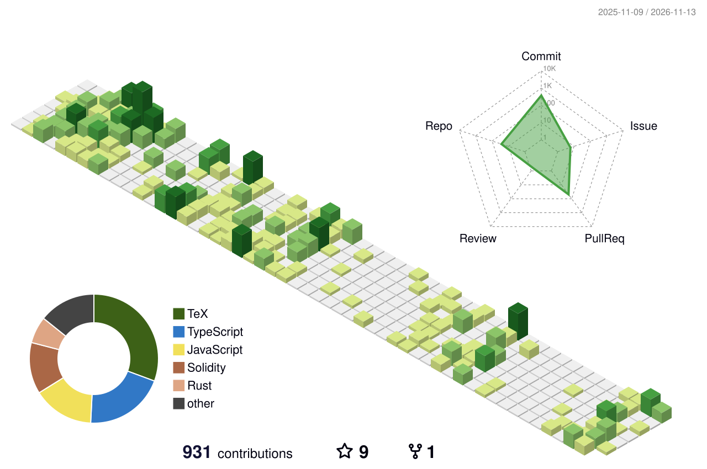

<!-- ====== BERSERK • MINIMAL & COMPACT ====== -->

  

  <!-- Hero -->
  

  

  
  <h1>Harshana Lakshara Fernando</h1>
  
<b>Software Engineer – Trading Systems @ CAL</b> • Go &amp; Kubernetes open source • Distributed Systems • Cloud-Native

  <!-- Socials / quick links (keep only working links) -->
        

  <!-- Quick facts -->
  
  
  
  

  

<!-- ===== 🙋 About ===== -->

  
<b>🙋 About me</b>

  

    <em>
      Hello! I'm Harshana Fernando, a <b>Software Engineer – Trading Systems</b> at CAL in Colombo, Sri Lanka
      (Computer Science &amp; Engineering, <a href="https://uom.lk/" title="Wisdom is all wealth"><b>University of Moratuwa</b></a>). 
      I'm a <b>passionate self-learner</b>
      
      and a <b>software engineer</b>
      .
    </em>
  

  

    I build scalable, cloud-native applications with strengths in full-stack development, microservices, and event-driven systems using <b>Java (Spring Boot)</b>, <b>Go</b>, and modern tooling.
    I'm passionate about Generative AI with hands-on experience in RAG pipelines and LLM integration, plus exposure to Web3 and DevOps.
  

  

    At CAL I build an in-house electronic trading platform connected directly to the Colombo Stock Exchange
    (FIX 5.0 SP2 order routing, an event-sourced engine on Chronicle Queue, Java 21). Outside work I contribute to CNCF and Kubeflow projects in Go.
    When I’m not shipping production-grade backends or tuning infra, I’m grinding <b>LeetCode</b> &amp; <b>HackerRank</b>.
  

<!-- ===== 💼 Experience ===== -->

<b>💼 Experience</b>

**Software Engineer – Trading Systems** · CAL · Colombo, Sri Lanka · *Sep 2026 – Present*
- Building CAL's in-house electronic trading platform: a direct gateway to the **Colombo Stock Exchange (CSE)**, plus the dealing, operations and testing tools around it
- Led CSE's **188-case exchange certification**, with a Certification Runner that drives each case and explains every field difference, backed by durable message logs and a CI-enforced test register
- **Event-sourced CQRS** order path: a **Chronicle Queue** write-ahead journal with **PostgreSQL** as an async read model, so no database write sits between a trader and the exchange
- **FIX 5.0 SP2** order routing and drop copy (**QuickFIX/J**), and a custom Java NIO decoder for the **MITCH** UDP multicast feed (A/B feeds, snapshot recovery)
- Designed an **exchange simulator** that replays 1,700+ real exchange conversations with **zero parity failures**
- Failover, sequence and feed-gap recovery, drop-copy reconciliation, health-gated deploys with rollback; **~1,050 automated tests** in CI

**Research and Development Engineer (Internship)** · Empathic Computing Laboratory, University of Auckland · Remote · *Mar 2026 – Aug 2026*
- Technical design of a modular mobile–wearable sensing pipeline (**Kotlin**, **WearOS**) for digital mental health research
- Turned high-frequency time-series sensor data into structured features for machine learning

**Co-founder & Lead Engineer (Freelance)** · ScaleX · Remote · *Jul 2025 – Aug 2026*
- Built **AgriNova** (Next.js, Prisma, Supabase/PostgreSQL): inventory and commission management across 5 branches, 194K+ units tracked, 860+ invoices processed
- Cut repeat dashboard data-fetch latency from ~384 ms to under 1 ms with React Query caching and pagination

**Software Engineer (Internship)** · Information Systems Associates (ISA) · Colombo, Sri Lanka · *Dec 2024 – May 2026*
- Owned a **Kafka**-backed PNR generation microservice, live in production: 25+ PNRs/sec/node at <100 ms latency
- Led the AeroMART → AeroOrder modernization (Strangler Fig, feature toggles, **gRPC** bridge into a Java 8 monolith)

Java 21 · Spring Boot · QuickFIX/J · Chronicle Queue · PostgreSQL · Kafka · Go · Kotlin

<!-- ===== 🌱 Open Source ===== -->

<b>🌱 Open Source</b>

<!-- OSS:START -->

  
  
  
  
  
  

**Pull requests**

| Project | PR | What I did | Size | Timeline | Status |
|---|---|---|---|---|---|
| [Apache Camel K](https://github.com/apache/camel-k) | [#6934](https://github.com/apache/camel-k/pull/6934) | Complexity linters (gocyclo, gocognit, cyclop) enabled at current-max thresholds ([#5486](https://github.com/apache/camel-k/issues/5486)), so complexity can't grow |  | Opened 5 Nov 2026 |  |
| [Apache Camel K](https://github.com/apache/camel-k) | [#6933](https://github.com/apache/camel-k/pull/6933) | Apache Pulsar scaler for the KEDA trait ([#6932](https://github.com/apache/camel-k/issues/6932)): scaler mapping, unit tests, an e2e test in the KEDA workflow and docs | 7 files · +426 −1 | Issue #6932 + PR opened 5 Nov 2026 |  |
| [Apache SkyWalking BanyanDB](https://github.com/apache/skywalking-banyandb) | [#1462](https://github.com/apache/skywalking-banyandb/pull/1462) | MCP HTTP server rejected `bearer` tokens (case-sensitive auth scheme); fix accepts any case with 4 new tests. Found it myself and filed [apache/skywalking#14199](https://github.com/apache/skywalking/issues/14199), now assigned to me; milestone BanyanDB 0.12.0 |  | Opened 5 Nov 2026 · issue #14199 assigned to me · milestone 0.12.0 |   |
| [kgateway](https://github.com/kgateway-dev/kgateway) (CNCF) | [#14851](https://github.com/kgateway-dev/kgateway/pull/14851) | New `kgateway_build_info` Prometheus metric (version, revision, Go version, OS/arch) so operators can see which build every pod runs. The maintainer extended it into a reusable `metrics.NewInfo` helper; issue [#13457](https://github.com/kgateway-dev/kgateway/issues/13457) closed as completed | 5 files · +113 | Opened 18 Oct → merged 20 Oct 2026 |   |
| [kubernetes-mcp-server](https://github.com/containers/kubernetes-mcp-server) | [#1549](https://github.com/containers/kubernetes-mcp-server/pull/1549) | Test that every tool, prompt, resource and resource template across all 12 toolsets declares valid RBAC metadata, using a real cluster inspector. All 14 CI checks green on the first run, approved on the first review (closes [#1435](https://github.com/containers/kubernetes-mcp-server/issues/1435)) | 1 file · +33 | Opened 20 Oct → merged 26 Oct 2026 |  |
| [kubernetes-mcp-server](https://github.com/containers/kubernetes-mcp-server) | [#1482](https://github.com/containers/kubernetes-mcp-server/pull/1482) | Fixed flaky HTTP server startup on the slow macOS CI runner: a 5 s readiness poll instead of a ~0.5 s retry loop, and test setup now cleans up before failing. Two review rounds (closes [#1445](https://github.com/containers/kubernetes-mcp-server/issues/1445)) | 2 files · +14 −14 | Opened 8 Oct → merged 15 Oct 2026 |  |
| [Kubeflow Spark Operator](https://github.com/kubeflow/spark-operator) | [#3249](https://github.com/kubeflow/spark-operator/pull/3249) | 20 Ginkgo specs for executor metrics: every pod-phase transition, label sanitising and registration error paths, 100% of `sparkpod_metrics.go`; plus a fix for a wrong failure-count log message. Requested by a maintainer under [#3202](https://github.com/kubeflow/spark-operator/issues/3202); review changes done | 4 files · +234 −1 | Opened 18 Oct · LGTM 20 Oct · waiting for /approve |   |
| [KEDA](https://github.com/kedacore/keda) (CNCF) | [#8317](https://github.com/kedacore/keda/pull/8317) | `onlyReadyPods` option for the Kubernetes workload scaler: counts only pods that are Running and Ready (not terminating), so scaling ignores pods that can't serve yet. Design agreed with a maintainer on [#4394](https://github.com/kedacore/keda/issues/4394); labelled `kind/feature` | 5 files · +207 −9 | Opened 27 Oct → merged 1 Nov 2026 |  |
| [KEDA](https://github.com/kedacore/keda) (CNCF) | [#8331](https://github.com/kedacore/keda/pull/8331) | Follow-up to [#8317](https://github.com/kedacore/keda/pull/8317) suggested by a maintainer: a shared `IsPodReady` helper in `pkg/util` (with tests) used by the workload scaler and fallback, replacing two copies | 5 files · +91 −37 | Opened 1 Nov → merged 5 Nov 2026 |  |
| [KEDA docs](https://github.com/kedacore/keda-docs) | [#1919](https://github.com/kedacore/keda-docs/pull/1919) | Documentation for the new `onlyReadyPods` parameter (companion to #8317) | 1 file · +4 | Opened 27 Oct → merged 1 Nov 2026 |  |
| [Jaeger](https://github.com/jaegertracing/jaeger) (CNCF) | [#9997](https://github.com/jaegertracing/jaeger/pull/9997) | Found and reported a bug in the MCP `get_trace_topology` tool ([#9991](https://github.com/jaegertracing/jaeger/issues/9991)): reused span IDs looped and parent cycles silently dropped spans. The fix links spans by position, expands each ID once and keeps output deterministic; 6 tests (self-parent, two cycles, shared IDs, depth limit) | 2 files · +192 −4 | Issue #9991 filed → PR opened 1 Nov 2026 |  |
| [kgateway](https://github.com/kgateway-dev/kgateway) (CNCF) | [#14945](https://github.com/kgateway-dev/kgateway/pull/14945) | `rateLimit.local.statPrefix` on the traffic policy, with route template tokens, so local rate-limit stats can be told apart per route ([#14925](https://github.com/kgateway-dev/kgateway/issues/14925)); unit and translator tests incl. strict mode; labelled `kind/feature` | 11 files · +555 −8 | Opened 29 Oct 2026 |  |
| [kubernetes-mcp-server](https://github.com/containers/kubernetes-mcp-server) | [#1521](https://github.com/containers/kubernetes-mcp-server/pull/1521) | Fixed `main` not building after two PRs merged out of order (Kiali status probe). The maintainer merged his own fix ([#1526](https://github.com/containers/kubernetes-mcp-server/pull/1526)) with the same code change plus a test | 1 file · +6 −2 | Opened 17 Oct · closed 20 Oct 2026 |  |

**Issues, debugging and design work**

| Project | Issue | What I did | When | Status |
|---|---|---|---|---|
| [Apache SkyWalking BanyanDB](https://github.com/apache/skywalking-banyandb) | [#14194](https://github.com/apache/skywalking/issues/14194) | Found and reported that the MCP server ignored `.env` values and silently accepted malformed settings (`1MiB` read as 1, invalid `TRANSPORT` falling back), with a reproduction; fix by another contributor in [banyandb#1460](https://github.com/apache/skywalking-banyandb/pull/1460), which credits the report | Reported 4 Nov 2026 · fix in banyandb#1460 (another contributor) |  |
| [kubernetes-mcp-server](https://github.com/containers/kubernetes-mcp-server) | [#1568](https://github.com/containers/kubernetes-mcp-server/issues/1568) | Showed a "flaky" test on another contributor's PR was a real merge-order bug, reproduced it and suggested the fix; the author confirmed, applied it and closed the issue as root-caused | 25 Oct 2026 |  |
| [Kubeflow Spark Operator](https://github.com/kubeflow/spark-operator) | [#3130](https://github.com/kubeflow/spark-operator/issues/3130) | Evaluated crd-ref-docs vs genref for migrating the API reference docs generator: sample output, line counts and field-accuracy checks (genref marked some optional fields as required); recommended crd-ref-docs | Assigned 22 Oct 2026 |  |
| [kgateway](https://github.com/kgateway-dev/kgateway) (CNCF) | [#14835](https://github.com/kgateway-dev/kgateway/issues/14835) | Metrics audit: posted an inventory of findings and offered a cleanup PR for the maintainer to pick | 22 Oct 2026 |  |

<!-- OSS:END -->
Also on my <a href="https://harshanalf.netlify.app/portfolio#open-source">portfolio</a> and <a href="https://uchihaithachi.github.io/cv/open-source.html">CV site</a>.

<!-- ===== 🎯 Goals & Focus ===== -->

<b>🎯 Goals & Focus</b>

- Build **scalable, cloud-native systems** (microservices, event-driven, high-throughput)  
- Ship **Java/Spring** & **Go** backends; optimize latency & reliability  
- Practical **RAG** and **LLM** integration  
- **Kubernetes** + **AWS** + secure CI/CD  
- Explore **Web3** (governance & identity)

<!-- ===== 🧰 Tech Stack (compact) ===== -->

<b>🧰 Tech Stack (compact)</b>

**Core**
  

**Backend / APIs**
  

**Frontend**
  

**Data / Messaging**
  

**Cloud / DevOps**
  

**GenAI**
  

> trimmed for speed. full toolbelt & projects live on my <b>Portfolio</b>.

<!-- ===== 📊 Stats ===== -->

<b>📊 GitHub Stats</b>

  

  

  

<!-- ===== 🏆 Extras ===== -->

<b>🏆 Trophies & Fun</b>

  

  

<!-- only works if the file exists in your repo -->

  

<!-- ===== 🩸 BERSERK ===== -->

<b>🩸 Berserk</b>

  

<i>“A dream can make a man feel alive. It gives him something to live for. But when that dream is over, it becomes a burden.” — Griffith</i>

<!-- ===== ☎️ Contact ===== -->

<b>☎️ Contact</b>

  
  
  
  
  <!-- Optional: add when ready -->
  
  
 

  Thanks for visiting — Projects & details live on my <a href="https://harshanalf.netlify.app/">Portfolio</a>. Last updated: 2026-10-28

  

  

